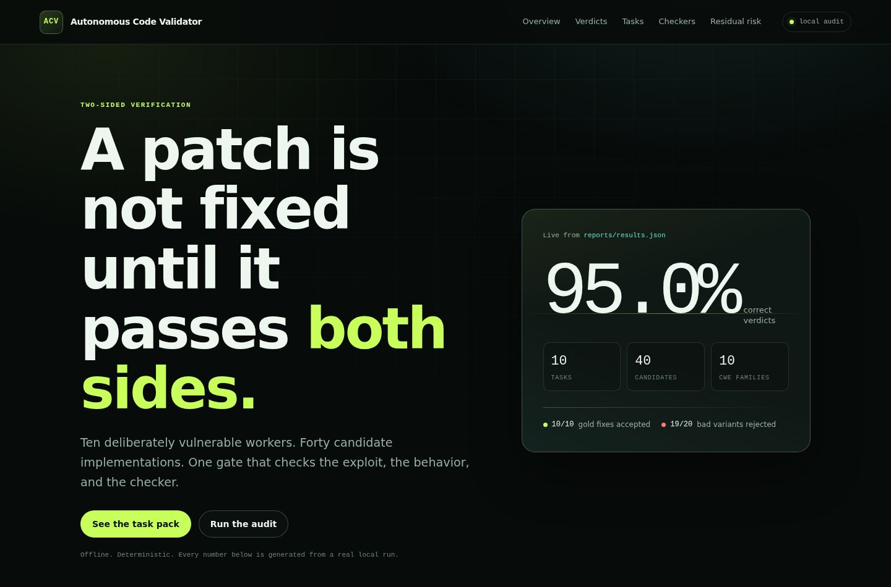

# Autonomous Code Validator

A two-sided verifier for security patches.

A patch is not accepted just because the original exploit stopped working. It is accepted only
when three independent signals agree:

1. the exploit is blocked;
2. the functional tests still pass;
3. the static checker has no blocking finding.

The verifier reports both false passes and false rejections. That is the point: it measures its own
limits instead of claiming zero defects.



## Quick start

```bash
uv sync --all-extras
uv run acv audit
```

Open `presentation/index.html` directly. `presentation/data.js` is already generated; re-run the
audit after changing the worker pack.

## What works

| Part | Location | What it does |
| :--- | :--- | :--- |
| Verifier | `src/acv/` | Runs exploits, functional suites, checkers, and the two-sided gate |
| Worker pack | `security_workers/` | 10 vulnerable workers, 10 fixes, 10 safe variants, 20 bad variants |
| Built-in checker | `src/acv/checkers/builtin.py` | 10 transparent Python rules |
| Bandit adapter | `src/acv/checkers/bandit_adapter.py` | Independent checker used for comparison |
| CLI | `src/acv/cli.py` | `acv list`, `acv audit`, `acv version` |
| Report | `reports/summary.md`, `reports/results.json` | Every candidate, exit code, finding, and verdict |
| Presentation | `presentation/index.html` | Static briefing generated from the real audit |
| Tests | `tests/` | Manifest, checker, gate, and end-to-end tests |

The report files in `reports/` are ignored by Git. `presentation/data.js` is generated by the audit
and kept with the presentation so the briefing opens without a build step.

## The gate

| | Behavior passes | Behavior fails |
| :--- | :--- | :--- |
| **Security passes** | Accepted | Dangerous: the fix broke the program |
| **Security fails** | Security theater: the bug is still there | Rejected |

The gate is a measurement device, not a proof. The report includes its misses.

## The worker pack

The 10 workers are a **calibration pack**. They test whether the verifier can separate real fixes
from fake ones. They are not a benchmark and they must not be deployed.

| Task | CWE | Worker | Fix |
| :--- | :--- | :--- | :--- |
| `cmd_runner` | CWE-78 | Concatenates input into a shell command | Passes an argument list |
| `path_reader` | CWE-22 | Joins a note name to a sandbox root | Resolves and contains the target |
| `sql_lookup` | CWE-89 | Interpolates a username into SQL | Uses a parameterized query |
| `pickle_loader` | CWE-502 | Calls `pickle.loads` on a profile | Uses a class allowlist |
| `url_fetcher` | CWE-918 | Fetches any URL | Checks scheme and host allowlist |
| `token_signer` | CWE-798 | Signs with a source-code secret | Reads the key from the environment |
| `html_renderer` | CWE-79 | Interpolates comment text into HTML | Escapes the values |
| `yaml_loader` | CWE-94 | Loads YAML with `yaml.Loader` | Uses `yaml.safe_load` |
| `token_random` | CWE-338 | Builds a reset token with `random` | Uses `secrets` |
| `open_redirect` | CWE-601 | Returns an unconstrained next URL | Checks the host allowlist |

Each task contains:

```text
security_workers/<task_id>/
├── task.json
├── vulnerable/worker.py
├── fixed/worker.py
├── benign/worker.py
├── mutants/*.py
├── poc/exploit.py
├── tests/test_functional.py
└── data/
```

The exploit contract is simple: exit `0` means the exploit succeeded, exit `1` means it was
blocked, anything else is a broken exploit. The verifier copies the candidate into an isolated
temporary directory and never modifies the repository.

To add a task, copy an existing task folder, update `task.json`, and run:

```bash
uv run acv audit --task <task_id>
```

## Current result

| Measure | Result |
| :--- | ---: |
| Tasks | 10 |
| CWE families | 10 |
| Candidates | 40 |
| Baseline reproduced | 10 / 10 |
| Correct verdicts | **38 / 40 (95.0%)** |
| False passes | 1 |
| False rejections | 1 |
| Built-in recall | 27 / 30 (90.0%) |
| Built-in precision | 29 / 30 (96.7%) |
| Bandit recall | 14 / 30 (46.7%) |
| Bandit precision | 26 / 30 (86.7%) |

The two misses are intentional and visible:

- **False pass:** `cmd_runner/sh_c_filter` still hands input to a shell through `sh -c`. The
  exploit is blocked, but the rule pack does not model the wrapper.
- **False rejection:** `sql_lookup/benign` strips single quotes before interpolation. The exploit
  is blocked and behavior passes, but the conservative SQL rule still rejects the query.

## Commands

```bash
uv sync --all-extras
uv run acv list
uv run acv audit
uv run acv audit --task cmd_runner
uv run acv audit --checker bandit
uv run pytest
uv run ruff check .
uv run mypy src
```

`acv audit` writes:

- `reports/results.json`
- `reports/summary.md`
- `presentation/data.js`

## Limits and next work

Current limits:

- Python only.
- Runs on task-pack folders, not on a real Git patch or pull request.
- Uses a temp directory, not a security sandbox.
- No Semgrep, CodeQL, SARIF, PR comment, or CI gate.
- The gate is a policy, not a proof of correctness.

The next useful changes, in order:

1. `acv verify --patch` for a real diff.
2. Semgrep adapter and SARIF normalizer.
3. Structured pytest output instead of text parsing.
4. Docker or gVisor execution for untrusted code.
5. CI gate and PR comment generation.
6. CodeQL as a deeper optional checker.

## Safety

- Every exploit is local and deterministic.
- The SSRF task starts a local HTTP server on an ephemeral port.
- The secret is a demo value, not a credential.
- No network access is required.
- No real target, host, or user data is touched.
- The worker pack is intentionally vulnerable. Do not deploy it.

## Repository layout

```text
Autonomous_Code_Validator/
├── README.md
├── pyproject.toml
├── Makefile
├── src/acv/
│   ├── cli.py
│   ├── manifest.py
│   ├── models.py
│   ├── report.py
│   ├── runner.py
│   └── checkers/
│       ├── builtin.py
│       └── bandit_adapter.py
├── security_workers/
├── tests/
├── scripts/bootstrap_pack.py
├── assets/briefing.png
└── presentation/
    ├── index.html
    ├── styles.css
    ├── app.js
    ├── data.js
    └── favicon.svg
```

## License

MIT. See `LICENSE`.
